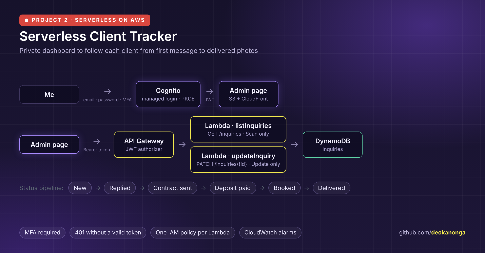

# Serverless Client Tracker on AWS

A private dashboard for my wedding photography business. Every inquiry couples send through my website (Project 1, `serverless-photography-website`) lands in DynamoDB; this project adds a login-protected admin page where I follow each client from first message to delivered photos.

New → Replied → Contract sent → Deposit paid → Booked → Delivered

I built it by hand in the AWS console to learn how authentication, APIs and least-privilege permissions fit together.

## Architecture



## Services and why

| Service | What it does here | Why |
|---|---|---|
| **Cognito** | User pool with self-registration off and MFA required (authenticator app). Hosted login page. | No passwords stored in my code; MFA for free. |
| **S3 + CloudFront** | Hosts `admin.html` next to the main site. | Same static hosting as Project 1, no server. |
| **API Gateway (HTTP API)** | `GET /inquiries` and `PATCH /inquiries/{id}`, both behind a **JWT authorizer** that checks the token's issuer (my user pool) and audience (my app client). | Requests without a valid token are rejected with 401 before any code runs. |
| **Lambda** | `listInquiries` returns every inquiry, newest first. `updateInquiry` changes only the status or private notes. | Two small functions, each with its own permissions. |
| **DynamoDB** | The same `Inquiries` table the website form writes to. | One source of truth for both projects. |
| **IAM** | One role per function: Scan only, or UpdateItem only (see [`iam/`](iam/)). | A bug in one function can't touch more than it needs. |
| **CloudWatch + SNS** | An alarm per function emails me on any error. | Problems surface without me checking logs. |

## How login works

1. The page creates a random secret (PKCE verifier) and sends only its SHA-256 hash to Cognito's login page.
2. After email, password and MFA code, Cognito redirects back with a one-time code.
3. The page trades that code plus the original secret for tokens. A stolen code is useless without the secret.
4. Tokens are kept in `sessionStorage` (gone when the tab closes) and sent as `Authorization: Bearer …` on every API call.

See [`frontend/admin.html`](frontend/admin.html), plain JavaScript with no frameworks or build step.

## Security

- No public sign-up; MFA required for the only user.
- Both API routes locked by the JWT authorizer. I verified with `curl` that calls without a token get **401 Unauthorized**.
- CORS limited to my own domains, with `GET`, `PATCH` and `POST` and the `authorization` header.
- `updateInquiry` accepts only the six known statuses and a notes field, refuses unknown IDs (`attribute_exists` condition), and escapes field names because `status` is a reserved word in DynamoDB.
- Everything a client typed is HTML-escaped before being shown on the page.

## Problems I hit

- **The console's "default" Lambda role grants broad access.** With "Custom execution role" switched off, the new Lambda wizard attaches far more than needed. I chose "basic permissions" and added a one-action inline policy instead.
- **A route without an authorizer is public.** After adding `PATCH`, I tested it without a token and it reached the Lambda. Attaching the authorizer per route (not per API) fixed it, and I now test every route unauthenticated.
- **A route with no integration returns 404**, which helped me tell "not connected" apart from "not allowed" (401).

## Cost

Effectively **$0**: Cognito, Lambda, API Gateway and DynamoDB all stay within free tiers for one user.

## What's next

- EventBridge scheduled reminders when a balance is due (14 days before the wedding).
- Infrastructure as code (AWS SAM or Terraform) for both projects.
- CI/CD with GitHub Actions to deploy the admin page.

## Repository structure

```
frontend/admin.html              the admin page (login, list, status, notes)
lambda/list_inquiries.py         GET /inquiries
lambda/update_inquiry.py         PATCH /inquiries/{id}
iam/list-inquiries-policy.json   Scan only
iam/update-inquiries-policy.json UpdateItem only
```

Account IDs, API IDs and Cognito IDs are replaced with placeholders like `<ACCOUNT_ID>`.
